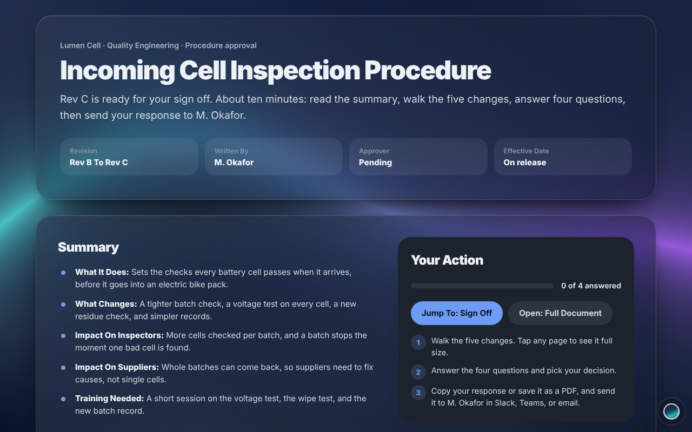

# Give Me The Greenlight

One page that walks a reviewer through a document, asks the questions that matter, and hands back a clear sign off they can paste into Slack, Teams, or email. No login, no server, nothing to install.

**[Try The Live Demo](https://auno-world.github.io/Give-Me-The-Greenlight/)** · [Sample Review](https://auno-world.github.io/Give-Me-The-Greenlight/template.html) · [Review Builder](https://auno-world.github.io/Give-Me-The-Greenlight/builder.html)



## What The Reviewer Gets

- **A summary first:** what the document does, what changed, and who it affects.
- **The document, change by change:** the new wording exactly as it will read, with notes on what to look for. Tap any page for Zoom or Full Page.
- **Clear questions:** each one answered with Agree, Agree With Minor Adjustments, or Needs A Change. A comment is required whenever something needs work.
- **A real sign off:** Approve, Approve With Comments, or Send Back For Changes, with their name and date.
- **An easy way back:** Copy: My Response for Slack, Teams, or email, or Save As PDF for the record.

Answers are saved only in the reviewer's own browser. They are deleted after 7 days without use, when the file is next opened. The same file can go to as many reviewers as you like.

## Pick Your Path

There are three ways to fill in a review. Pick the one that fits how your company works. They all produce the same page.

| | Review Builder | AI Prompt | Python Script |
|---|---|---|---|
| **How it works** | Type into a form with a live preview, then download. | An AI drafts the content from your document; you check it in the Builder. | Write one `review.json` file, add page images, run one command. |
| **Easiest for** | Anyone, any computer | The fastest first draft | Repeat reviews and shared folders |
| **Install needed** | None, just a browser | None | Python 3 |
| **Uses AI tokens** | No | Yes, more for long documents | No |
| **Effort** | More manual typing | Least typing, but check its work | A little setup, then fast |
| **Worth checking** | Nothing | Your company's rules on sharing documents with AI | Whether your computer allows Python |

### Review Builder

1. Open `builder.html` (or the [live Builder](https://auno-world.github.io/Give-Me-The-Greenlight/builder.html)).
2. Fill in the document, summary, changes, and questions. Add a screenshot of each page if you want Zoom and Full Page to show the real page.
3. Choose **Download: Review**. The file is named after your document, for example `Incoming Cell Inspection Procedure Rev C Review.html`.

Your draft is kept in your browser while you work. Use **Download: Draft Backup** to save a JSON copy. The Builder checks required fields, whole page numbers, unique change and question IDs, and question links before it downloads a review. You can optionally enter **Total Pages** for page labels and a **Full Document Link** to a web copy. Without the link, the review offers **Open: First Change**.

### AI Prompt

1. Copy the prompt in [`prompts/ai-prompt.md`](prompts/ai-prompt.md) into the AI chat your company allows, and attach your document.
2. Save its answer as `review.json`.
3. In the Builder, choose **Open: Existing Review**, pick `review.json`, check every change against your document, and download.

### Python Script

```bash
python3 make_review.py examples/lumen-cell
```

Put `review.json` and any page images in one folder and point the script at it. It builds a single finished file in that folder, with the images inside. Standard library only. Start from [`examples/lumen-cell/review.json`](examples/lumen-cell/review.json). Each change needs an ID, title, wording, and whole page number of 1 or more. Each question needs a unique ID, text, and a link to an existing change. The script adds a `reviewId` and missing question IDs once, saving them back to `review.json` so later builds keep the same identity. Optional `totalPages` must be at least as large as every change page. Optional `fullDocUrl` must be an HTTP or HTTPS link. Local images must stay inside the review folder and be PNG, JPEG, GIF, or WebP files no larger than 5 MB each.

## Privacy

Answers are stored as plain text in the reviewer's browser. The page requests the Inter font from Google Fonts and falls back to system fonts offline. Images supplied as web links load from those sites; embed images for fully offline use. No review or answer content is uploaded by the page. The AI route follows the policies of whichever AI the author uses.

### Coding Agents

Codex, Claude Code, Copilot, and similar tools can build a review straight from a document. [`AGENTS.md`](AGENTS.md) tells them the rules.

## Files

| File | What It Is |
|---|---|
| `template.html` | The review page, with fictional sample content |
| `builder.html` | The Review Builder |
| `make_review.py` | The Python script |
| `prompts/ai-prompt.md` | The AI prompt |
| `examples/` | Fictional sample content |
| `AGENTS.md` | Rules for coding agents |

## Versions

Every page shows its version in the footer, and every review records the version that built it. See [`CHANGELOG.md`](CHANGELOG.md) and the [releases](https://github.com/Auno-World/Give-Me-The-Greenlight/releases).

## Before You Build

New to Aūno tools? Read [Before You Build](https://github.com/Auno-World#before-you-build) for tips on picking the right path, checking your setup, and keeping real information on your side.

Ideas and fixes are welcome. See [Contributing](https://github.com/Auno-World/.github/blob/main/CONTRIBUTING.md).

---

MIT licensed. Sample content is fictional. Built by **Aūno**.
